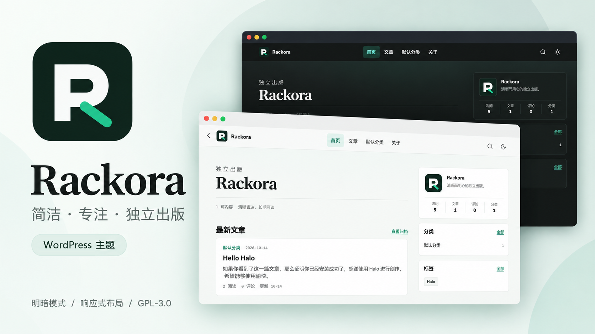
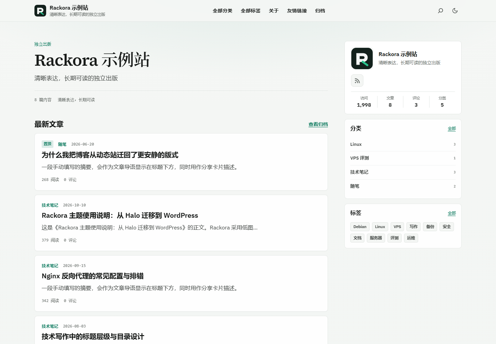
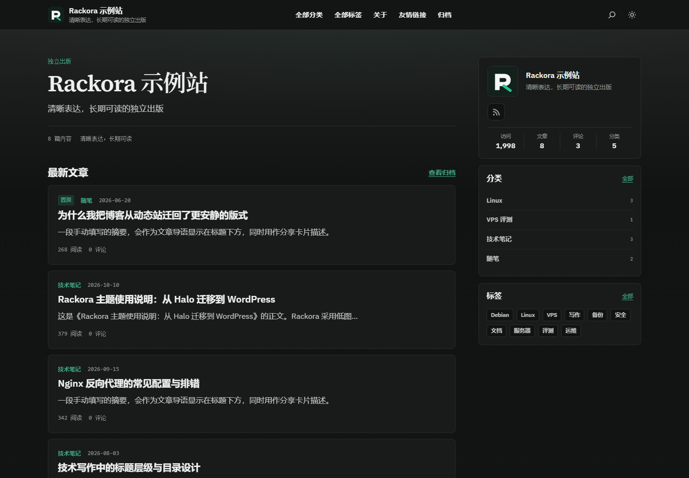
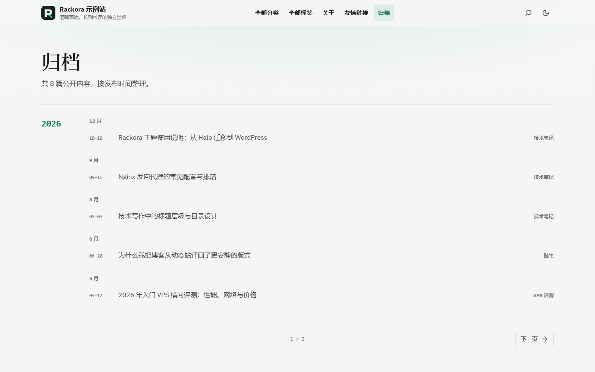

<div align="center">


# Rackora for WordPress

内容优先的 WordPress 区块主题

</div>

Rackora 是一个面向独立博客、知识库与技术写作的内容优先主题，由 [Halo 版 Rackora](https://github.com/everett7623/halo-theme-rackora) 移植而来。前台保持 Halo 版安静、低图片的出版式版式；底层完全按 WordPress 区块主题（全站编辑）实现：`theme.json` 设计令牌、区块模板与模式、核心区块优先，Rackora 特有的组件以服务端渲染的自定义区块提供。

- 当前版本：`v0.5.0`
- 环境要求：WordPress `>= 6.6`（已在 7.1 测试），PHP `>= 7.4`
- 更新日志：[CHANGELOG.md](CHANGELOG.md)
- 许可证：[GPL-3.0-or-later](LICENSE)
- 问题反馈：[GitHub Issues](https://github.com/everett7623/wordpress-theme-rackora/issues)



## 界面预览

|                         首页（浅色）                          |                          首页（深色）                          |
| :-----------------------------------------------------------: | :------------------------------------------------------------: |
|  |  |
|                          **文章页**                           |                           **手机端**                           |
|  |  |
|                          **归档页**                           |                                                                |
|  |                                                                |

## 主要功能

- 首页资料卡（Logo、副标题、社交账号、站点统计）、带文章数的分类、高频标签与置顶标记。
- 文章页：面包屑、导语、作者与日期、核验日期、阅读时长与阅读数、推广关系披露、目录与标题锚点、阅读进度、代码高亮与复制、响应式表格与产品比较表、图片放大、标签、分享栏、文章系列、相关文章、版权声明、相邻文章与评论。
- 文档模板：目录常驻侧栏，同分类文章列表高亮当前篇。
- 归档时间线、全部分类、全部标签、友情链接与关于页模板；日期归档同样使用时间线。
- 浅色、深色与跟随系统三种配色，访客的选择保存在浏览器中且首屏无闪烁；打印样式与减少动态效果。
- 页面级 SEO：`<meta name="description">`、自指 canonical（含列表分页）、`rel="prev/next"`、Open Graph（含 `article:section` 与 `article:tag`）、Twitter Card，以及 WebSite（含 SearchAction）、Organization、BlogPosting / TechArticle（含字数、分类与关键字）、BreadcrumbList、CollectionPage、ProfilePage、WebPage / AboutPage 结构化数据；检测到 SEO 插件时自动让位。
- 文章与页面可独立设置 SEO 标题、SEO 描述与搜索索引策略（noindex）；搜索页、标签页与日期归档可 noindex；`robots.txt` 在主题接管 SEO 时屏蔽站内搜索。
- 文章目录服务端渲染大纲；阅读数可限「仅文章」并带服务端限流。
- 可选的 GA4、Microsoft Clarity、百度统计，ICP / 公网安备信息与带披露的推广位，默认均不启用或不显示。
- 自带简体中文翻译，界面语言跟随「设置 → 常规 → 站点语言」。

## 安装

1. 从 [Releases](https://github.com/everett7623/wordpress-theme-rackora/releases) 下载 `rackora-X.Y.Z.zip`。
2. 打开「外观 → 主题 → 安装主题 → 上传主题」，选择 ZIP 并启用。

主题运行时不需要任何构建步骤，也可以直接把仓库克隆到 `wp-content/themes/rackora`。

## 快速上手

1. **站点资料**：在「设置 → 常规」填写站点标题与副标题；Logo 和站点图标在站点编辑器的站点 Logo 区块中设置，未设置时使用 Rackora 默认图标。
2. **索引页**：新建以下页面，别名对应时会自动套用模板，也可以在页面设置里手动选择模板。

   | 页面     | 别名         | 模板                 |
   | -------- | ------------ | -------------------- |
   | 归档     | `archives`   | 归档                 |
   | 全部分类 | `categories` | 全部分类             |
   | 全部标签 | `tags`       | 全部标签             |
   | 友情链接 | `links`      | 友情链接             |
   | 关于     | `about`      | 关于页（About）      |

   页面的手动摘要会作为标题下的简介。首页的「查看归档」、侧栏的「全部」与页脚链接会自动指向这些页面。

3. **导航**：在「外观 → 编辑器 → 导航」创建菜单，页头与页脚的导航区块都可以选择菜单。
4. **样式**：配色、字体、字号与全站宽度在「外观 → 编辑器 → 样式」中调整；深色模式会根据强调色自动推导亮色版本。
5. **主题设置**：「外观 → Rackora」只放 WordPress 没有原生位置的选项：默认配色、建站日期、备案、默认许可与分享、推广披露、SEO（含社交主页预设）、阅读数范围与访问分析。
6. **文档模板**：编辑文章时在「模板」中选择「文档（Documentation）」。

## Halo 版设置对照

Halo 版的 9 组主题设置在 WordPress 中分散到了各自的原生位置：

| Halo 设置                        | WordPress 中的位置                                                          |
| -------------------------------- | --------------------------------------------------------------------------- |
| 界面语言、网站语言               | 「设置 → 常规 → 站点语言」，主题自带 `zh_CN` 翻译                           |
| 社交账号                         | 前台图标：资料卡/关于页「社交图标」区块；SEO sameAs：「外观 → Rackora」预设槽 |
| 页脚说明、页脚菜单、署名、RSS    | 站点编辑器中的页脚模板部件                                                  |
| 首页侧栏统计、建站日期           | 「站点统计」区块；建站日期优先用区块属性，否则读「外观 → Rackora」          |
| Logo 展示方式与上传              | 站点 Logo 区块（调整宽度即可使用横向 Logo）                                 |
| 默认配色                         | 「外观 → Rackora」                                                          |
| 强调色、全站宽度、正文字号       | 站点编辑器「样式」                                                          |
| 文章封面、首页横幅、首页文案     | 在模板中添加特色图片 / 封面区块，或直接编辑标题区文字                       |
| 侧栏、目录、最新文章、最新评论   | 在文章模板中增删对应区块                                                    |
| 分享平台、相关文章、系列、许可   | 默认分享与许可在「外观 → Rackora」；单篇仍可用区块属性覆盖；相关/系列为区块属性 |
| 友情链接                         | 「链接」管理器（链接分类即分组）+ 友情链接页面                              |
| SEO、站点验证、组织信息          | 「外观 → Rackora」                                                          |
| 访问分析                         | 「外观 → Rackora」                                                          |
| 广告位                           | 「推广位」区块与「推广卡片」子区块；默认披露文案在「外观 → Rackora」        |
| 备案信息                         | 「外观 → Rackora」；页脚「备案信息」区块可覆盖                              |
| 文章元数据（关键词、系列等）     | 文章编辑器侧栏的「Rackora」面板                                             |
| 标签索引策略 / 简介              | 标签编辑页的「索引策略」与原生「描述」                                      |
| 分类精选文章                     | 分类编辑页的「精选文章」                                                    |

## 主题区块

除核心区块外，Rackora 提供以下服务端渲染区块（插入器中的「Rackora」分类）：

| 区块           | 用途                                         | 区块             | 用途                             |
| -------------- | -------------------------------------------- | ---------------- | -------------------------------- |
| 首页标题区     | 眉题、站点标题 H1、副标题、文章数            | 站点统计         | 访问、文章、评论、分类与运行天数 |
| 文章卡片       | 放在查询循环的文章模板中                     | 分页导航         | 上一页 / 页码 / 下一页           |
| 归档标题       | 归档、搜索与索引页的 H1 和简介               | 归档时间线       | 按年月分组的文章列表             |
| 文章信息       | 导语、作者、日期、核验、阅读时长与阅读数     | 推广关系披露     | 推广、送测、自购声明             |
| 文章目录       | 由正文 H2 / H3 生成，小屏为抽屉              | 本文最新评论     | 文章侧栏中的评论摘要             |
| 分享栏         | 8 个平台与复制链接                           | 文章系列         | 同系列文章，按序号排序           |
| 相关文章       | 同主分类优先，回退到首个标签                 | 作者与版权声明   | 原文地址、作者、日期与许可       |
| 分类精选文章   | 分类页顶部的精选入口                         | 分类 / 标签汇总  | 全部分类或全部标签网格           |
| 友情链接       | 读取「链接」管理器，支持分组筛选             | 配色切换         | 页头的明暗切换按钮               |
| 推广位、推广卡片 | 带披露的静态推广，自动添加 sponsored 等属性 | 备案信息         | ICP 与公网安备号                 |

## SEO 与插件

Rackora 自行输出 `<meta name="description">`、canonical、Open Graph、Twitter Card、结构化数据与 robots 规则。检测到 Yoast SEO、Rank Math、All in One SEO、SEOPress、The SEO Framework、Slim SEO 或 Squirrly SEO 时，这些输出会自动停用以免重复；站点验证与主题统计仍由各自开关控制。也可以在「外观 → Rackora」中手动关闭，或通过 `rackora_seo_active` 过滤器控制。

标签页、日期归档与搜索结果默认输出 `noindex,follow`，可在设置中关闭标签 / 日期规则；单个标签 / 分类可在编辑页单独允许或禁止索引。主题接管 SEO 时，`robots.txt` 会补齐 `User-agent` 并屏蔽 `/?s=` 与 `/search/`。站点地图使用 WordPress 自带的 `wp-sitemap.xml`；若使用 SEO 插件，改用该插件的站点地图。

## 隐私与外部服务

默认安装不会加载任何第三方脚本、字体或统计：字体、图标与代码高亮都随主题打包。只有站点管理员主动开启后才会请求外部服务：

| 能力              | 设置位置         | 外部地址                   | 默认 |
| ----------------- | ---------------- | -------------------------- | ---- |
| GA4               | 外观 → Rackora   | `www.googletagmanager.com` | 关闭；默不统计已登录用户 |
| Microsoft Clarity | 外观 → Rackora   | `www.clarity.ms`           | 关闭 |
| 百度统计          | 外观 → Rackora   | `hm.baidu.com`             | 关闭 |
| 分享按钮          | 分享栏区块       | 点击后跳转到对应平台       | 显示 |

阅读计数保存在本站数据库中：同一浏览器会话每篇只计一次，能编辑该文章的登录用户与常见爬虫不计数。可在设置中关闭，或通过 `rackora_should_count_view` 过滤器调整规则。

## 开发

```bash
pnpm install
pnpm check
```

- `pnpm check`：检查版本号、JSON、区块与模式引用、翻译完整性、脚本行数与 PHP 语法。
- `pnpm vendor`：升级 highlight.js 或调整语言列表后重新打包 `assets/vendor/highlight.min.js`。
- `pnpm zip`：用 `git archive` 生成 `dist/rackora-X.Y.Z.zip`，只包含已提交的文件。

更新翻译需要 [WP-CLI](https://wp-cli.org/)：

```bash
wp i18n make-pot . languages/rackora.pot --exclude=node_modules,scripts,assets/vendor
wp i18n update-po languages/rackora.pot languages/zh_CN.po
wp i18n make-mo languages
wp i18n make-php languages
```

目录结构：

```text
theme.json        设计令牌、自定义模板与模板部件
templates/        区块模板（内容来自同名模式）
parts/            页头与页脚模板部件
patterns/         模板内容与可插入的模式（PHP，便于翻译）
blocks/           自定义区块：block.json + render.php + style.css
inc/              主题设置、SEO、统计、元数据、阅读计数与区块注册
assets/css/       全局样式与按需加载的核心区块样式
assets/js/        前台 Script Modules 与编辑器脚本
languages/        翻译模板与简体中文翻译
```

## 发布

1. 同步 `style.css` 与 `package.json` 的版本号，运行 `pnpm check`。
2. 提交后创建 `vX.Y.Z` 标签并推送，GitHub Actions 会检查主题、打包 ZIP 并发布 Release。

## 许可证

Rackora 以 [GPL-3.0-or-later](LICENSE) 发布。随主题分发的 IBM Plex Sans、Source Serif 4（OFL-1.1）、Highlight.js（BSD-3-Clause）与 Lucide 图标（ISC）的版权声明与许可证原文见 [THIRD_PARTY_LICENSES.txt](THIRD_PARTY_LICENSES.txt)。
